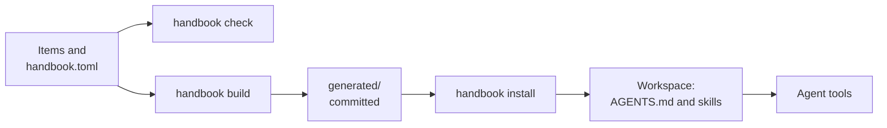

# handbook-framework

A **handbook** is the baseline agents work from: how a person or an organization works and builds, written
as small items that reach agents when they apply. This framework defines what a handbook is, and provides
the `handbook` command that checks one, builds what agents read from it, and installs it into a workspace.

The framework holds no content and no opinions. Each owner writes their own handbook; the framework gives
it a shape, checks it, and delivers it to any agent tool.

> **Pre-release.** The spec and the documentation exist; the `handbook` command is being built. The first
> versions are `0.x`.

## What is a handbook?
A repository of **items**, each one file stating one thing an agent should know about its owner.

- **Owner:** the person or organization a handbook belongs to.
- **Item:** one statement, in `<domain>/<slug>.md`, identified as `<domain>.<slug>`.
- **Kind:** what an item is: a principle, working agreement, rule, guideline, procedure, reference or
  decision. The kind decides how binding the item is, when agents receive it, and its sections.
- **Domain:** the topic an item belongs to, such as `delivery` or `quality`. Domains are practice (how the
  owner works) or system (what one system is).
- **Always-on core:** the principles and working agreements, which are in an agent's context on every
  task.
- **Framework:** this repository: the [spec](spec/README.md), and the `handbook` command.

## How it works



`handbook check` validates the items against the spec. `handbook build` turns them into what agents read:
the always-on core, one skill per domain and one per procedure, and an index. `handbook install` puts them
into a workspace, through open standards (`AGENTS.md` and [Agent Skills](https://agentskills.io)), so any
agent tool finds them. More in
[how agent tools receive a handbook](docs/concepts/how-agent-tools-receive-a-handbook.md).

## An example
An item, `quality/test-through-public-behavior.md`:

```markdown
---
id: quality.test-through-public-behavior
kind: guideline
title: Test through public behavior
summary: Tests exercise use cases and public interfaces, not private functions
applies_when: Writing or changing tests
status: active
---

# Test through public behavior

## Guideline
Tests exercise the use cases and public interfaces of a component, and assert outcomes.

## Reason
Tests of private functions break on every refactor that keeps behavior the same.
```

And the handbook around it:

```
handbook.toml       name, prefix, framework version, domains
handbook            the launcher: ./handbook check
collaboration/      one folder per domain, one file per item
delivery/
quality/
  test-through-public-behavior.md
generated/          written by handbook build
```

## Questions

**What belongs in a handbook?**
Only what a capable agent would not do unprompted: your preferences, your conventions, your constraints,
and facts only you have. For example, "pull requests are squash merged, and their titles are Conventional
Commits" belongs; "write readable code" does not. See
[what belongs in a handbook](docs/guides/what-belongs-in-a-handbook.md).

**Which kind is a statement?**
Ask the classification questions in order and take the first yes. For example, "pull request titles are
Conventional Commits, and CI checks them" is binding and a tool enforces it, so it is a rule. See
[kinds of item](docs/concepts/kinds-of-item.md).

**How does an agent find the right item?**
Through its `applies_when`. For example, a guideline that applies "when writing or changing tests" is part
of the `quality` skill, which the agent tool loads when the task is writing tests.

**When does something deserve a decision record?**
When a choice shapes a system or an organization, sets a contract others depend on, chooses a language,
tool or platform, changes a way of working, or is costly to reverse. For example, choosing the language of
a new service. See [writing a decision](docs/guides/writing-a-decision.md).

**Does it work with my agent tool?**
It delivers through open standards, which most agent tools read. For those that read only their own files,
`handbook install` adds the pointers and links they need. See the
[decision](docs/adr/standards-first-with-bridge-adapters.md).

**Who keeps a handbook current?**
Its owner, through reviewed changes, like code. Agents propose updates in pull requests. For example, after
correcting an agent the same way twice, ask it to propose that correction as a guideline.

## Documentation

| Read | For |
|---|---|
| [Concepts](docs/concepts/README.md) | What a handbook is, its kinds, domains and statuses, and how it reaches agents |
| [Guides](docs/guides/README.md) | What belongs in a handbook, and how to write each kind of item |
| [Spec](spec/README.md) | What a handbook is, as data and schemas |
| [Decisions](docs/adr/README.md) | Why the framework is designed the way it is |

## Contributing
How this project works, from issue to merge: [CONTRIBUTING.md](CONTRIBUTING.md). Work is planned in the
[issues](https://github.com/Migas99/handbook-framework/issues) and on the
[project](https://github.com/users/Migas99/projects/2). To report a vulnerability: [SECURITY.md](SECURITY.md).

## License
Created by José Cunha. Licensed under the [Apache License, Version 2.0](LICENSE); see also
[NOTICE](NOTICE). Files that the `handbook` command generates in your handbook belong to you.
