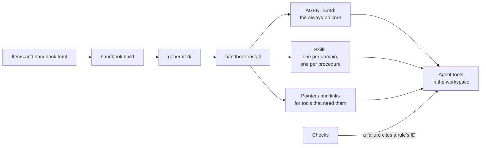

# How agent tools receive a handbook

A handbook reaches agents in two steps. `handbook build` turns its items into what agents read, in the
handbook's `generated/` folder, which is committed so that every review shows what agents will receive.
`handbook install` then puts that into a workspace, where agent tools find it.

## What reaches an agent, and when
- **Always:** the always-on core, in `AGENTS.md`: the principles and working agreements, and a short guide
  to the handbook. Its size is reported by `handbook check`, because it costs context on every task.
- **When the task matches:** one skill per domain, whose description is built from its items'
  `applies_when`; the agent tool loads a domain's items when the task matches. Each procedure is a skill of
  its own.
- **When a check fails:** the failure names the rule it enforces by its ID, and the agent loads that rule,
  whose *When it fails* section says how to comply.
- **When looked up:** an index of every item, with its summary and `applies_when`, for people and for
  tools without skills.

## Open standards first
Everything is delivered through open standards: `AGENTS.md`, skills in the
[Agent Skills](https://agentskills.io) format, and later an MCP server. A tool that follows them needs
nothing else. For tools that read only their own files, `handbook install` adds pointers and links, from
an adapter table in the framework, the only place where agent tools are named
([decision](../adr/standards-first-with-bridge-adapters.md)).
