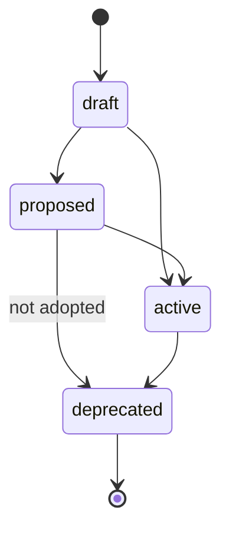
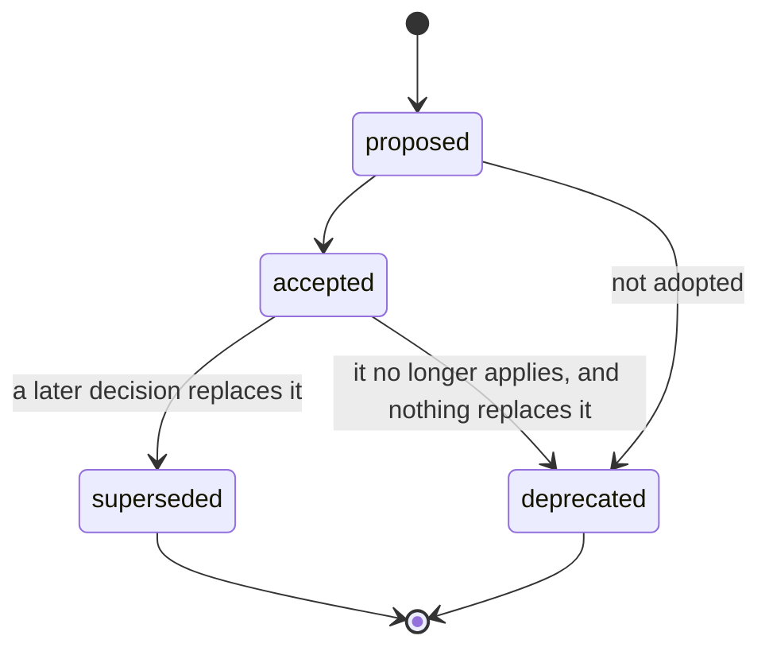

# Statuses and their lifecycle

Every item has a **status**, which says how settled it is and whether agents receive it. What each status
means is in [spec/statuses.yaml](../../spec/statuses.yaml), and which kinds can have which status is in the
[item schema](../../spec/schemas/item.schema.json). Only items that apply reach agents: drafts and
proposals are not yet decided, and items that no longer apply have been replaced or retired.

Most items move like this:

Decisions have their own lifecycle, because an accepted decision is never edited: when it changes, a new
decision supersedes it, and the old one names its successor.

## Retiring an item
An item that no longer applies is deprecated or superseded, never deleted. Its file stays, so its ID can
never be given to another item, and every past reference to it still means what it meant. Agents stop
receiving it.
