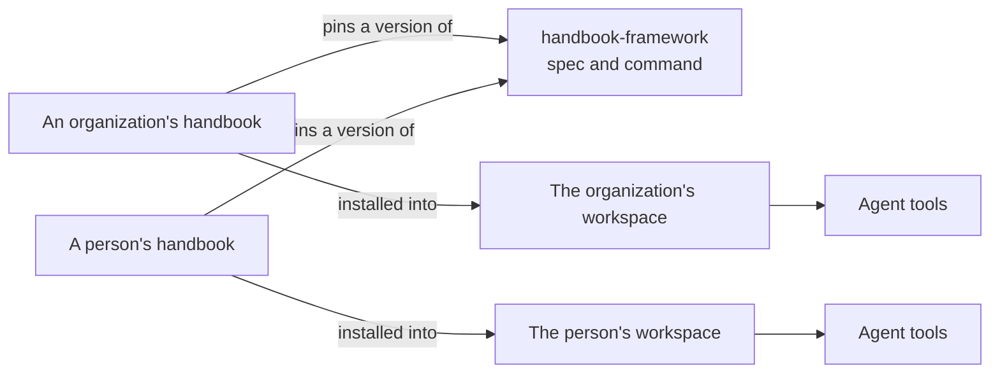

# What a handbook is

A **handbook** holds how a person or an organization works and builds: the values they judge by, how
agents should work with them, the requirements their checks enforce, their defaults, their procedures,
the facts they look up, and the decisions behind it all. Agents use it as the baseline for their work;
people read it as documentation.

Three things are involved:

- **An owner:** a person or an organization.
- **The owner's handbook:** a repository of items, with its configuration in `handbook.toml`. The handbook
  is the owner's instance of the framework.
- **The framework:** this repository. It defines what a handbook is (the [spec](../../spec/README.md)),
  and provides the `handbook` command that checks a handbook, builds what agents read from it, and
  installs it into a workspace.

## What the framework holds, and what it does not
The framework holds no content and no opinions. Every handbook is written by its owner; the framework
gives it a shape, checks it, and delivers it. Dependencies point one way: handbooks depend on a version of
the framework, and the framework depends on no handbook
([decision](../adr/public-and-depending-on-no-instance.md)).

## One context, one handbook
A workspace follows exactly one handbook, and handbooks are never merged. A person who works for an
organization and on their own projects keeps them in separate workspaces, each with its own handbook
([decision](../adr/one-instance-per-workspace.md)).

## What belongs in a handbook
Only what an agent would not do on its own. Every item an agent reads costs context on every task, and
helps only when it states something that differs from a capable model's defaults: a preference, a
convention, a constraint, or a fact that lives only with the owner.
